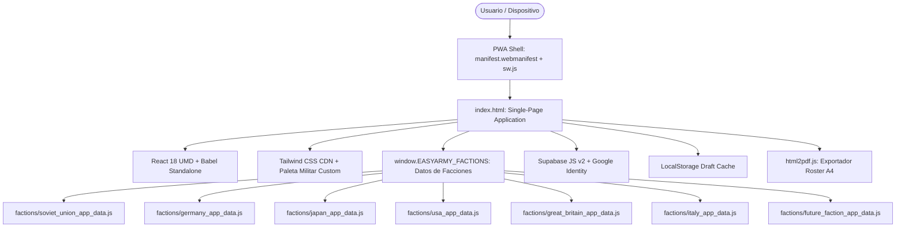

# 📘 MANUAL DE PROYECTO Y GUÍA TÉCNICA — ARMY MAKER (BOLT ACTION v3)

> **Documento de Referencia Permanente para Desarrolladores y Arquitectura del Sistema**  
> Bolt Action: Tercera Edición (v3) • Zero-Build React 18 SPA • Motor Multi-Facción Modular

---

## 1. Visión General del Proyecto

**ARMY MAKER** es un constructor y gestor de listas de ejército para el juego de miniaturas históricas **Bolt Action: Tercera Edición (v3)**.

Su diseño prioriza:
1. **Fidelidad al 100% con EasyArmy (`wg.easyarmy.com`)**: Nomenclatura oficial, periodos históricos (All, Early War, Mid War, Late War), estructura de pelotones, opciones de equipamiento y costes en puntos.
2. **Filosofía Zero-Build**: No requiere empaquetadores en tiempo de compilación (Webpack, Vite, Rollup) para ejecutarse en producción. Funciona abriendo directamente `index.html` en cualquier navegador web moderno o mediante cualquier servidor de archivos estáticos (GitHub Pages, Live Server, `start.bat`).
3. **PWA Standalone & Offline-First**: Instalable en dispositivos móviles, tablets y ordenadores de escritorio como una aplicación nativa sin barras de navegación gracias a `manifest.webmanifest` y `sw.js`.
4. **Sincronización Híbrida**: Almacenamiento local ultrarrápido y reactivo en `localStorage`, respaldado con persistencia en la nube mediante **Supabase (PostgreSQL + RLS)** y autenticación con **Google OAuth**.
5. **Generador de Roster Oficial PDF**: Impresión y exportación A4 limpia con desglose balístico por unidad, reglas especiales contextuales, notas de pelotón y resumen de dados de orden.

---

## 2. Arquitectura de Software y Stack Tecnológico



### Tecnologías Clave

| Módulo | Tecnología | Justificación y Ventajas |
| :--- | :--- | :--- |
| **Núcleo de UI** | React 18 (UMD) + Babel Standalone | Permite desarrollo modular con JSX reactivo sin necesidad de build steps pesados. |
| **Diseño y Estilos** | Tailwind CSS (CDN) | Clases utilitarias y paleta táctica militar (`#161B15`, `#20281E`, `#3D4B34`, `#C4A238`, `#733028`). |
| **Iconografía** | SVG Nativos en Línea + Iconos Tácticos OTAN | Cero peticiones HTTP externas. Símbolos reglamentarios adaptativos de Bolt Action v3. |
| **Base de Datos / Cloud** | Supabase JS v2 | Guardado y recuperación de listas en PostgreSQL con Row Level Security (RLS). |
| **Autenticación** | Google Identity Services | Inicio de sesión con un solo clic con botón oficial o personalizado. |
| **PDF Engine** | `html2pdf.js` (`html2canvas` + `jsPDF`) | Generación en cliente de hojas de lista A4 vectorizadas para competición y torneo. |
| **Caché Offline** | Service Worker (`sw.js`) | Estrategia *Stale-While-Revalidate* para librerías y datos; *Network-First* para la shell. |

---

## 3. Estructura de Directorios del Repositorio

```text
army-maker/
├── index.html                   # Esqueleto de la aplicación: CDNs, enlaces de scripts y contenedor raíz
├── config.js                    # Credenciales públicas seguras de Supabase y cliente OAuth
├── manifest.webmanifest         # Manifiesto PWA para instalación de la app
├── sw.js                        # Service Worker v8 (estrategia offline y precache de todos los módulos)
├── package.json                 # Configuración de herramientas de desarrollo y suite de tests
├── vite.config.js               # Servidor de desarrollo local ligero
├── PROJECT_MANUAL.md            # Este manual de arquitectura y guía técnica
├── ARCHITECTURE.md              # Documento complementario de diseño de software
├── README.md                    # Descripción general del proyecto
│
├── css/                         # CAPA DE ESTILOS Y PRESENTACIÓN
│   └── styles.css               # Temas militares, scrollbars tácticas, animaciones y reglas @media print A4
│
├── js/                          # CAPA LÓGICA Y SERVICIOS
│   ├── engine.js                # Motor de reglas Bolt Action v3 (puntos, dados, desglose balístico de armas)
│   ├── storage.js               # Servicios de persistencia (Supabase Cloud, LocalStorage y hook useAuth)
│   ├── icons.js                 # Iconografía SVG y símbolos tácticos OTAN
│   ├── app.js                   # Componente raíz App (estado de lista, layout y navegación de pelotones)
│   └── components/              # COMPONENTES MODULARES DE INTERFAZ
│       ├── Modals.js            # ModalShell, AuthModal, SavedListRow, MyListsModal, ExportModal
│       ├── UnitEditModal.js     # Modal de dos columnas: selección de experiencia, opciones, armas y reglas
│       ├── Slot.js              # Casilla individual de pelotón con buscador desplegable de unidades
│       └── ArmyRosterPrintView.js # Hoja oficial de batalla y vista previa A4 para torneo
│
├── factions/                    # MÓDULOS DE DATOS DE LAS GRANDES POTENCIAS V3
│   ├── soviet_union_app_data.js # Catálogo completo: Unión Soviética (v3)
│   ├── germany_app_data.js      # Catálogo completo: Alemania (v3)
│   ├── japan_app_data.js        # Catálogo completo: Japón Imperial (v3)
│   ├── usa_app_data.js          # Catálogo completo: Estados Unidos (v3)
│   ├── great_britain_app_data.js# Catálogo completo: Gran Bretaña (v3)
│   ├── italy_app_data.js        # Catálogo completo: Italia (v3)
│   ├── france_app_data.js       # Catálogo completo: Francia (v3)
│
├── scripts/                     # SCRIPTS DE DESARROLLO Y VERIFICACIÓN
│   ├── verify_easyarmy.js       # Suite de auditoría automatizada contra EasyArmy (`npm test`)
│   └── make_icons.js            # Generador de iconos PWA
│
├── icons/                       # Iconos de la PWA (192x192, 512x512, SVG, Apple Touch)
├── images/                      # Ilustraciones e imágenes de unidades tácticas
└── supabase/                    # Esquemas SQL de base de datos
    └── schema.sql               # Tabla `saved_lists` con políticas RLS
```

---

## 4. Estado de la Aplicación y Flujo de Datos

El estado principal reside en el componente raíz `App` dentro de `js/app.js`:

```javascript
// Variables de estado clave en App
const [activeFactionId, setActiveFactionId] = useState('germany'); // ID de facción seleccionada
const [platoons, setPlatoons] = useState([...]);                 // Array de pelotones activos
const [activePlatoonId, setActivePlatoonId] = useState(1);       // Pelotón actualmente en pantalla
const [armyListName, setArmyListName] = useState('');            // Nombre asignado a la lista
const [armyNotes, setArmyNotes] = useState('');                  // Notas libres del jugador
const [activePeriod, setActivePeriod] = useState('All');         // Filtro temporal: All, EW, MW, LW
```

### Estructura de un Pelotón en Memoria
```javascript
{
  id: 1,                          // Identificador numérico único dentro de la lista
  typeId: 'rifle',                // Tipo de pelotón (rifle, heavy_weapons, recce, etc.)
  period: 'All',                  // Periodo asignado al pelotón (All, EW, MW, LW)
  slots: {
    "cmd_1": {
      name: "Second Lieutenant",
      exp: "regular",
      extraMen: 1,
      options: {
        "smg": true
      }
    },
    "inf_1": {
      name: "Heer Veteran Grenadier Squad",
      exp: "veteran",
      extraMen: 5,
      options: {
        "assault_rifle": true,
        "assault_rifles": 2,
        "lmg": 1,
        "panzerfaust": 2
      }
    }
  }
}
```

---

## 5. Motores de Cálculo de Bolt Action v3

### 5.1. Motor de Puntos (`calculateUnitPoints`)
Calcula el coste exacto en puntos de una unidad configurada:
1. **Coste Base**: Determinado por el nivel de experiencia (`inexperienced`, `regular`, `veteran`) definido en `def.costs[exp].points`.
2. **Soldados Extra**: Si `extraMen > 0`, se suma `extraMen * def.costs[exp].extraCost`.
3. **Opciones Booleanas (`checkbox`)**: Si está activa, se suma `opt.cost` (o se resta si es un descuento negativo).
4. **Opciones Numéricas (`counter`)**: Se multiplica la cantidad por `opt.cost`.
5. **Opciones por Hombre (`per_man`)**: Se calcula `totalHombres * opt.costPerMan`.

### 5.2. Motor de Dados de Orden (`calculatePlatoonDice`)
Cada unidad de combate válida asignada a una casilla genera **1 dado de orden** para el pelotón. Los transportes asignados a escuadras también se contabilizan como dados de orden individuales según las reglas de Bolt Action v3.

### 5.3. Motor de Desglose Balístico (`buildUnitRosterTable`)
Construye la tabla de armas y dotación con fidelidad total a EasyArmy:
- **Vehículos y Transportes**: Identifica el chasis blindado, valor de daño (`Damage Value`), transportes, armas fijas, armas en torreta y mejoras de chasis (como *Schürzen*, blindaje frontal reforzado o afustes *pintle*).
- **Equipos y Artillería**: Desglosa cañones, obuses, morteros pesados, ametralladoras medianas, dotaciones y opciones especiales (como escudos protectores *Gun Shield* o servidores de observación *Spotter*).
- **Escuadras de Infantería y Cuarteles Generales**:
  - Identifica el líder (`NCO`, `Officer`, `Commissar`, `Medic`, `Observer`).
  - Asigna las armas especiales del líder (subfusil, rifle de asalto *Sturmgewehr*, pistola o espada *Shin Gunto*).
  - Distribuye las armas secundarias de la escuadra (ametralladoras ligeras *LMG*, morteros ligeros / *knee mortars*, rifles antitanque, lanzallamas, cargas de demolición y proyectiles *Panzerfaust*).
  - Calcula automáticamente los soldados restantes que conservan el arma estándar reglamentaria (fusil o subfusil).

---

## 6. Esquema de Datos de Facción (`factions/<id>_app_data.js`)

Cada archivo de facción se registra automáticamente en el objeto global `window.EASYARMY_FACTIONS`:

```javascript
window.EASYARMY_FACTIONS = window.EASYARMY_FACTIONS || {};

window.EASYARMY_FACTIONS['nombre_facción'] = {
  id: 'nombre_facción',          // Identificador canónico en minúsculas y sin espacios
  faction: 'Nombre Oficial',      // Nombre legible (ej: 'Germany', 'Soviet Union')
  book: 'Armies of ... (v3)',     // Manual de referencia oficial
  flag: 'bandera_o_icono',        // Código o identificador de icono

  // Colección de los 6 tipos de pelotones oficiales v3
  platoons: [
    {
      id: 'rifle',                // Identificador del tipo de pelotón
      title: 'RIFLE PLATOON',     // Título en mayúsculas
      name: 'Rifle Platoon',      // Nombre descriptivo
      officialTitle: '** v3 Armies of ... - Rifle (All)',
      columns: [
        {
          id: 'col_1',
          slots: [
            { id: 'cmd_1', label: 'Platoon Commander', slotKey: 'Platoon Commander', mandatory: true },
            { id: 'inf_1', label: 'Infantry', slotKey: 'Infantry', mandatory: true },
            { id: 'inf_2', label: 'Infantry', slotKey: 'Infantry', mandatory: true },
            { id: 'inf_3', label: 'Infantry', slotKey: 'Infantry', mandatory: false },
            { id: 'inf_4', label: 'Infantry', slotKey: 'Infantry', mandatory: false }
          ]
        },
        // Columnas col_2 a col_5: Armas de apoyo, artillería, vehículos y transportes
      ]
    }
  ],

  // Catálogo completo de unidades de la facción
  units: {
    "Nombre de la Unidad": {
      name: "Nombre de la Unidad",
      cardTitle: "Nombre de la Unidad",
      composition: "1 NCO and 4 Men",      // Composición inicial
      defaultExp: "regular",               // inexperience | regular | veteran
      maxExtraMen: 5,                      // Cantidad máxima de soldados adicionales
      costs: {
        regular: { points: 50, extraCost: 10 },
        veteran: { points: 65, extraCost: 13 }
      },
      weapons: "Rifles",
      specialRulesText: "Reglas especiales separadas por coma",
      optionsList: [
        { id: "smg_nco", type: "checkbox", label: "NCO may have an SMG", cost: 5 },
        { id: "lmg", type: "counter", label: "Up to 2 men may have an LMG", cost: 20, max: 2 }
      ],
      weaponsTable: [
        { name: "Rifle", range: '24"', shots: "1", pen: "n/a", special: "" },
        { name: "Light machine gun", range: '36"', shots: "4", pen: "n/a", special: "" }
      ],
      unitRules: [
        { name: "Nombre Regla", text: "Descripción detallada de la regla." }
      ]
    }
  }
};
```

---

## 7. Guía Paso a Paso: Cómo Añadir una Nueva Facción

Gracias a la arquitectura desacoplada, incorporar una nueva facción (como Estados Unidos `usa`, Gran Bretaña `great_britain` o Italia `italy`) toma solo 4 pasos sin alterar el código central de los componentes:

### Paso 1: Crear el Archivo de Datos de la Facción
Crea `factions/<nueva_facción>_app_data.js` siguiendo el esquema de la sección anterior (o adaptando el dataset extraído con el scraper de EasyArmy).

### Paso 2: Registrar el Script en `index.html`
Abre `index.html` y añade la etiqueta `<script>` en la sección `<!-- Faction Data Modules -->`:

```html
<!-- Faction Data Modules -->
<script src="./factions/soviet_union_app_data.js"></script>
<script src="./factions/germany_app_data.js"></script>
<script src="./factions/japan_app_data.js"></script>
<script src="./factions/<nueva_facción>_app_data.js"></script>
```

### Paso 3: Detección Automática en la UI
No necesitas tocar ningún componente de React. En `js/app.js`, `FACTIONS_REGISTRY` lee automáticamente todas las claves de `window.EASYARMY_FACTIONS`. La nueva facción aparecerá de inmediato en el selector de la cabecera con su nombre oficial (`appBundle.faction`).

### Paso 4: Añadir la Ruta al Precache de `sw.js` (Opcional para PWA Offline)
Abre `sw.js` e incluye la ruta en el array `PRECACHE` y sube la versión de caché para soporte offline:

```javascript
const PRECACHE = [
  './',
  './index.html',
  './config.js',
  './manifest.webmanifest',
  './css/styles.css',
  './js/engine.js',
  './js/storage.js',
  './js/icons.js',
  './js/components/Modals.js',
  './js/components/UnitEditModal.js',
  './js/components/Slot.js',
  './js/components/ArmyRosterPrintView.js',
  './js/app.js',
  './factions/soviet_union_app_data.js',
  './factions/germany_app_data.js',
  './factions/japan_app_data.js',
  './factions/usa_app_data.js',
  './factions/great_britain_app_data.js',
  './factions/italy_app_data.js',
  './factions/<nueva_facción>_app_data.js',
];
```
  './manifest.webmanifest',
  './factions/soviet_union_app_data.js',
  './factions/germany_app_data.js',
  './factions/japan_app_data.js',
  './factions/usa_app_data.js',
  './factions/great_britain_app_data.js',
  './factions/italy_app_data.js',
  // ...
];
```

---

## 8. Verificación y Auditoría Automatizada (`npm test`)

El proyecto cuenta con un sistema de pruebas automatizado que compara directamente la base de datos de la aplicación con los datos en bruto de EasyArmy (`scripts/verify_easyarmy.js`).

Para ejecutar la verificación:
```bash
npm test
```

### Elementos Auditados en Cada Facción:
- **Pelotones**: Verifica la presencia y estructura exacta de los 6 tipos de pelotón reglamentarios.
- **Casillas (`slots`)**: Comprueba cada casilla, su clave de categoría y su obligatoriedad (`mandatory`).
- **Unidades**: Valida que el 100% de las unidades del catálogo pertenezcan a la facción y dispongan de costes por experiencia válidos.
- **Opciones**: Comprueba identificadores de opciones, tipos (`checkbox`, `counter`, `per_man`), costes y límites máximos.
- **Periodos Históricos**: Valida que los filtros de periodo (`All`, `EW`, `MW`, `LW`) coincidan estrictamente con EasyArmy.

**Resultado Actual (6 Grandes Potencias de la Segunda Guerra Mundial)**:
- Unión Soviética: 124 unidades, 303 opciones auditadas.
- Alemania: 216 unidades, 448 opciones auditadas.
- Japón Imperial: 94 unidades, 332 opciones auditadas.
- Estados Unidos: 128 unidades, 331 opciones auditadas.
- Gran Bretaña: 148 unidades, 351 opciones auditadas.
- Italia: 72 unidades, 250 opciones auditadas.
- **Total: 782 unidades y 2.015 opciones en 36 pelotones oficiales**.
- **Total Advertencias / Discrepancias: 0 (100% de paridad con EasyArmy v3)**.

---

## 9. Registro de Optimizaciones y Refactorizaciones Realizadas

1. **Eliminación de Dependencias Fantasma**:
   - Se removieron de `package.json` dependencias no utilizadas en producción (`react`, `react-dom`, `@tailwindcss/vite`, `lucide-react`, `clsx`).
   - Se limpió `vite.config.js` dejándolo como un servidor estático ligero.
2. **Deduplicación de Componentes UI**:
   - `GoogleIcon`: Se unificaron 3 bloques idénticos de marcado SVG en un único componente reutilizable.
   - `SavedListRow`: Se consolidó la visualización de tarjetas de listas en la nube y en local en `MyListsModal`, eliminando más de 70 líneas duplicadas.
   - `QuantityStepper`: Se creó un componente común para los controles de incremento/decremento en `UnitEditModal`.
3. **Optimización de Rendimiento en Renderizado**:
   - En el componente `Slot`, el cálculo de unidades disponibles y filtradas ahora evalúa de forma inmediata `if (!isOpen) return []`. Esto previene cientos de operaciones de filtrado innecesarias en cada tecleo o cambio de estado.
4. **Protección Balística en Expresiones Regulares**:
   - `findUnitWeaponRow` incluye un parámetro de exclusión `excludeRegex` para evitar que búsquedas de fusiles estándar (`Rifle`) coincidan accidentalmente con fusiles de asalto (`Assault rifle` / `Sturmgewehr`).
   - Soporte multi-facción completo en la tabla de roster: espadas *Shin Gunto* japonesas, cargas de demolición, morteros de rodilla, blindajes *Schürzen* alemanes y proyectiles *Panzerfaust*.
